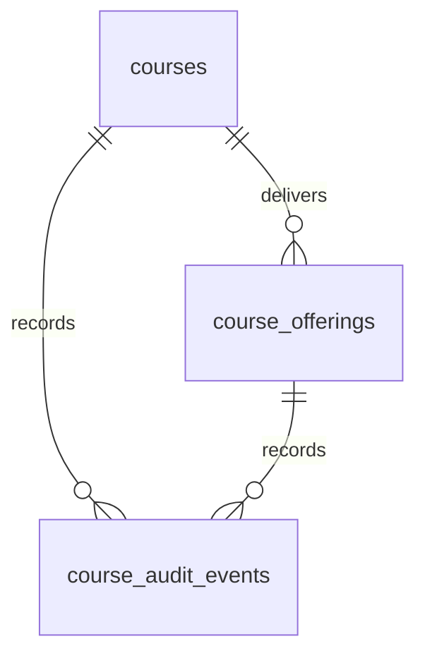

# Course Service

## Overview and ownership

`services/course` is an independently deployable Go 1.27.2, Gin, PostgreSQL,
pgx/v5 service. It owns reusable courses and their academic offerings. It does
not own users, credentials, enrollments, grades, notifications, or enrollment
counts. IDs for users are external UUID references; `course_offerings.course_id`
is a local foreign key. No other service database is read.

The service has two aggregate roots. A `Course` owns its definition, code, and
lifecycle. A `CourseOffering` owns one delivery, one optional primary lecturer,
enrollment configuration, and its lifecycle. Offerings are loaded and changed
individually; updating a course does not load its offerings.

## Domain and lifecycle



```text
Course:          draft -> active -> archived -> active
                 draft ------------> archived
Offering:        draft -> published -> closed -> archived -> draft
                 draft -> archived; published -> archived
```

`publish` activates a Course; an Offering can publish only when its parent is
active and it has an eligible lecturer. Publication does not mean enrollment is
currently open. The Enrollment Service must check offering status, opening and
closing timestamps, and capacity when processing an enrollment. An archived
offering is not eligible for new enrollments. Restoration returns an offering to
`draft`, never to `published`, and does not reopen enrollment.

Course codes are unique across this service's database, including archives.
Codes are uppercased and can change only while the course is draft and has no
offerings. An archived course cannot receive offerings. Course archival is
rejected while any draft or published offering exists. Closed and archived
offerings remain as academic history. Course archival never cascades.

Offering dates are inclusive calendar dates with `end_date >= start_date`.
Enrollment timestamps are UTC; when both exist, closing must follow opening.
Capacity is optional (`NULL` means unlimited) and, when set, is 1–100000.
Published offerings lock academic period, start/end dates, and enrollment
opening time. Closing time may only be extended. Capacity may only be raised
from a configured value. A published offering cannot switch between unlimited
and configured capacity.
The service cannot safely lower capacity without an Enrollment Service
validation contract, which does not exist yet. A
[proposed coordination contract](proposals/enrollment-capacity-change.md) is
documented separately and is not implemented.

The parent course ID and lecturer are absent from the general update DTO.
Lecturer assignment is a separate admin operation and writes an audit event
with the previous and new IDs. Every write increments `version`, except an
idempotent reassignment to the same lecturer. A client must submit the version
it last read; stale writes receive `409 version_conflict`.

## Authorization

All public endpoints require an Ed25519 access JWT issued by Auth Service.
The service checks issuer, audience, expiration, key ID, and token type. Cookie
authentication requires a matching CSRF header on unsafe methods. Roles and
permissions both matter for writes; lecturer operations also compare JWT
subject to `lecturer_user_id` on the target offering.

| Actor | Course read | Course changes | Offering read | Offering changes |
| --- | --- | --- | --- | --- |
| ADMIN | All | `courses:manage` | All | `offerings:manage`; assignment and restore also require `courses:manage` |
| LECTURER | Active | None | Published and own assigned drafts | Own assigned offering with `offerings:manage`; no assignment or restoration |
| STUDENT | Active | None | Published | None |

The existing Auth permission migration grants `courses:manage` and
`offerings:manage` to ADMIN, and `offerings:manage` to LECTURER. An Auth
administrator can alter permission grants; a grant to STUDENT still cannot
authorize Course Service mutations. The public catalogue is authenticated,
matching existing User Service conventions. Draft/archived resources are not
revealed to students. Lecturer self mutations and publication recheck live
eligibility to reduce the stale JWT window.

## API

The complete request and response contract is in
[OpenAPI](openapi/course-service.yaml). Public routes use `/api/v1`; NGINX
proxies them to port 8083 without rewriting. Every mutation body has explicit
fields. Unknown JSON fields and trailing JSON are rejected. Pagination uses
`limit` (default 20, maximum 100) and `offset` (default 0), with a `total`
count. Query filters include `search`, `status`, `sort`, and `order`, plus
offering period and lecturer filters. Students see only active courses and
published offerings even if a different status is requested.

| Method | Path | Action |
| --- | --- | --- |
| GET | `/api/v1/courses` | List and search courses |
| GET | `/api/v1/courses/{id}` | Get course |
| GET | `/api/v1/courses/{id}/offerings` | List course offerings |
| POST | `/api/v1/admin/courses` | Create course |
| PUT | `/api/v1/admin/courses/{id}` | Update course |
| POST | `/api/v1/admin/courses/{id}/{publish,archive,restore}` | Course transitions |
| GET | `/api/v1/offerings` | List and search offerings |
| GET | `/api/v1/offerings/assigned` | List own assigned offerings |
| GET | `/api/v1/offerings/{id}` | Get offering |
| PUT | `/api/v1/offerings/{id}` | Update offering |
| POST | `/api/v1/offerings/{id}/{publish,close,archive}` | Offering transitions |
| POST | `/api/v1/admin/offerings` | Create offering |
| PUT | `/api/v1/admin/offerings/{id}/lecturer` | Assign or reassign lecturer |
| POST | `/api/v1/admin/offerings/{id}/restore` | Restore to draft |
| GET | `/internal/offerings/{id}` | HMAC-only Offering facts for Enrollment |

Errors follow the repository envelope:
`{"error":{"code":"validation_failed","message":"...","request_id":"..."}}`.
Invalid input is 400, missing authentication 401, forbidden operations 403,
missing resources 404, conflicts 409, invalid lecturer 422, and unavailable
eligibility services 503. SQL details and secrets are never returned.

## Database and migrations

Migration `000001_course_schema` creates `courses`, `course_offerings`, and
`course_audit_events`. Unique course code, local foreign key, status, date,
capacity, assignment completeness, archive timestamp, and version checks are
enforced in PostgreSQL. Indexes support status/code catalogue reads,
course-offering listings, lecturer listings, status/start-date listings, period
filters, and audit lookups. Audit entries are committed with the domain write.
They are local records; there is currently no Audit Service delivery contract.

Use a distinct `courses` database and `course_app` credential. From
`services/course`, configure `.env`, then run:

```sh
go run ./cmd/migrate -direction up
go run .
```

`go run ./cmd/migrate -direction version` reports state. `-direction down
-steps 1` rolls back; it **drops all Course data** at version 1 and is for
disposable environments only. Existing production Course schema does not
precede this migration. Future upgrades must use numbered migrations.

## Configuration and local execution

Copy `services/course/.env.example` to `services/course/.env`. Required values
are database host/name/user/password, the Auth public key map, and the shared
internal service secret (at least 32 characters). The example includes all
variables and defaults. Important settings:

| Variable | Purpose |
| --- | --- |
| `COURSE_SERVICE_PORT`, `BIND_HOST` | HTTP listener, default `8083` on loopback |
| `DB_*` | Dedicated PostgreSQL connection and TLS mode |
| `AUTH_JWT_PUBLIC_KEYS_JSON`, `AUTH_JWT_ISSUER`, `AUTH_JWT_AUDIENCE`, `AUTH_JWT_CLOCK_SKEW` | Auth token verification |
| `INTERNAL_SERVICE_ID`, `INTERNAL_SERVICE_SECRET` | HMAC signed internal calls |
| `USER_SERVICE_INTERNAL_URL`, `USER_SERVICE_TIMEOUT` | Live registration approval check |
| `AUTH_SERVICE_INTERNAL_URL`, `AUTH_SERVICE_TIMEOUT` | Live lecturer role and activation check |
| `HTTP_*_TIMEOUT`, `SHUTDOWN_TIMEOUT`, `MAX_REQUEST_BYTES` | HTTP operation limits |
| `CORS_*`, `TRUSTED_PROXIES`, `AUTH_COOKIE_ENABLED` | Edge and browser security |

Set `INTERNAL_ALLOWED_CALLERS=auth-service,course-service,enrollment-service`
on User Service and
`INTERNAL_ALLOWED_CALLERS=user-service,course-service,enrollment-service`
on Auth Service. Course permits `enrollment-service` on its signed Offering
facts endpoint. Services participating in signed internal calls must use
matching shared secrets. No internal endpoint is routed through NGINX. In
Docker, set `BIND_HOST=0.0.0.0` and use service DNS names for
internal URLs and `DB_HOST`; the Dockerfile is in `services/course`. Build from
the repository root with `docker build -f services/course/Dockerfile
-t university-course-service services/course`. The image contains both the
service and migration binary. On the deployment network, run the migration
before starting the service with `docker run --rm --env-file
services/course/.env --entrypoint /app/course-migrate
university-course-service -path /app/migrations -direction up`; then start the
image normally with the same environment and network. Set database and service
hosts in the container environment to reachable DNS names. The repo does not
contain a Compose deployment, so the container must be attached to a network
with PostgreSQL, Auth, and User services by the operator.

`GET /health` reports liveness. `GET /health/ready` checks database connectivity
and requires a clean Course schema migration at version 1 or newer, with a two
second deadline. The service logs structured JSON, propagates
request IDs, and shuts down gracefully. Readiness does not probe Auth or User;
their availability is checked during eligibility operations.

## Tests and integration boundaries

Run `go test ./...`, `go vet ./...`, and `go build ./...` in `services/course`.
Repository integration tests run only with `TEST_DATABASE_URL` pointing to a
dedicated database named exactly `courses_test`; apply the same migrations to
that database first. Tests refuse other database names. The Auth integration
suite likewise uses a dedicated `auth_test` database.

Lecturer assignment requires User Service approval via signed
`GET /internal/users/{id}` and Auth Service role/activation via signed
`GET /internal/users/{id}/lecturer-eligibility`. Either failure denies the
assignment. Auth owns role membership; User owns registration lifecycle.
Enrollment Service must consume Offering configuration and enforce capacity
transactionally. No Enrollment Service API exists yet, so Course Service
cannot validate a capacity decrease against current enrollments. There is no
established Course event consumer or message broker contract; domain changes
are recorded atomically in the local audit table and no event delivery is
claimed. Assessment, Notification, and Analytics integrations remain future
contracts.

## Assumptions and open policy

The more specific confirmed decision to assign one lecturer **per offering**
governs the earlier phrase "one lecturer per Course". A course can therefore
have offerings taught by different lecturers. Admin creates offerings;
lecturers manage only assigned offerings and publish directly. Department is
omitted because no authoritative department model exists. Academic year and
semester are free-form, bounded strings. Archives are retained and course
codes are never reused. Published offering archives are allowed; whether
Enrollment Service needs additional coordination before that transition is
unresolved. Existing JWTs may remain valid until their ten minute expiry after
a role or account change; lecturer mutations recheck eligibility, but read
access still relies on JWT claims. A future Enrollment contract is needed for
safe capacity reduction and for downstream enrollment availability checks.
