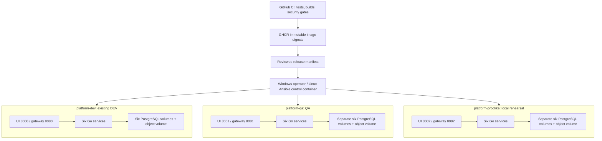
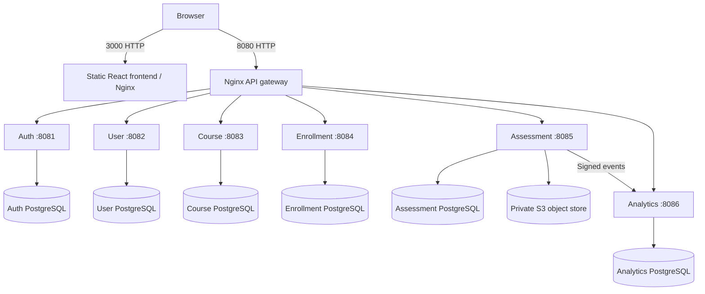

# Infrastructure Architecture

Last validated: 2026-11-23 on Docker Desktop's Linux engine (Docker 29.9.3,
Compose v5.7.0).

## Current Phase 3–5 deployment architecture

Use the [Deployment Guide](deployment-guide.md) and the
[Phase 3](phase-3-report.md), [Phase 4](phase-4-report.md) and
[Phase 5](phase-5-report.md) reports for current operation and acceptance evidence.
The original DEV topology and dated Phase 1/2 observations below remain useful
baseline history; they are not claims of live Production readiness.

See the [validation ledger](validation-ledger.md) for executed acceptance commands,
final runtime evidence and the complete changed-file inventory.

| Environment | Compose project | UI / gateway host ports | Application/configuration model |
| --- | --- | --- | --- |
| DEV | `platform-dev` | Existing 3000 / 8080 | Existing secrets, signing keys, storage and running image IDs preserved |
| QA | `platform-qa` | Loopback 3001 / 8081 | Independent local credentials, issuer, cookies, keys, six DBs and object data |
| PROD-like | `platform-prodlike` | Loopback 3002 / 8082 | Local production rehearsal, independent credentials and data; not live Production |

All three use the same six domain services and internal ports, six PostgreSQL
databases, object storage, migrations and Nginx routes. There are no extra domain
services, caches, brokers, remote servers or cloud resources. Each project owns
`edge`, `backend`, `data` networks and seven persistent named volumes. External
volumes, fixed container names, host-backed volume driver aliases, private port
publication and cross-environment credentials are rejected by deployment guards.
Rehearsals run sequentially on this 8 GiB Desktop engine while DEV stays running.



Compose remains shared, with small DEV/QA/PROD-like overrides. Configurable
`*_ENV_FILE` inputs preserve existing DEV paths and select separate rehearsal
runtime files. `*_IMAGE` variables select the same promoted artifact without
rebuilding per environment. Registry manifests permit exactly nine digest-pinned
application/helper images and cannot inject project names or secrets. Local
`:candidate` tags are build conveniences, not immutable release identifiers.

Ansible uses explicit local inventories, preflight/config validation, optional
Vault input rendering, application updates, Nginx validation and health checks.
Windows uses a trusted disposable control container because native Ubuntu Docker
socket access is unavailable. The socket grants host-equivalent Docker access;
no personal-PC SSH service or internet-facing runner is introduced. Registry
promotion/rollback remain conditional on real published manifests and credentials.

Source modules/builders receive the Go 1.27.3 security patch and patched
`x/crypto`, `x/net`, `x/text` and Assessment compression dependencies. The Nginx
1.30.7 digest stays pinned, with a fixed libxml2 runtime security floor. The
storage helper and rehearsal object servers use the verified vendor November
security release. Existing DEV containers/storage are deliberately not upgraded
in place; its retained older artifacts need a separately controlled update.
Review vendor storage upgrade requirements, backups and a maintenance window
before applying a new storage release to existing DEV data.

QA/PROD-like application/edge filesystems are read-only with bounded scratch
tmpfs. Go processes are non-root with capabilities dropped; Nginx retains only
master/worker startup capabilities. PIDs, memory, logs and restart behavior are
bounded, with database/object data writable only in their named volumes. Database
application identities still use bootstrap superuser privileges. PostgreSQL 18
rejected an attempted QA demotion; the experiment was withdrawn. Separate
migration/runtime identities require a reviewed ownership/grant transition
before live Production. DEV privileges were not changed.
These local resource limits are not production capacity or load-test results.

Auth private keys use the existing file loader through a read-only Compose secret
in rehearsals. Other Go secrets remain environment-based, visible to Docker
administrators. Vault templates/activation, Windows file ACLs, no-log rendering,
ignored secret paths and per-environment keys/issuers/cookie names reduce local
exposure. No production cloud secret manager is active, and plaintext rehearsal
inputs under a synced checkout are not suitable for live secrets. Future Azure
Key Vault/managed identity or AWS Secrets Manager/IAM roles are documented, not
provisioned.

Backups are per-environment, non-overwriting PostgreSQL logical archives plus
scoped object copies, non-secret recovery configuration, image IDs and checksums.
Defaults are outside Git/OneDrive; secret/key recovery is separately Vault-managed.
Archive listing and synthetic object recovery are verified without restoring or
deleting any existing database. No production backup schedule, off-site retention,
TLS certificate, remote host hardening or disaster-recovery guarantee is active.

GitHub-hosted workflows do not deploy to this PC. Publishing uses `GITHUB_TOKEN`
only on trusted refs after CI, scans exact digests, and releases immutable
manifests. GitHub owner protection/package administration and actual hosted
execution remain separate acceptance items; no workflow was dispatched or image
published during implementation. The current account returned a plan-related
403 for branch protection and has no configured environments.

### Original DEV reference and Phase 1/2 history

The current audit, reproducible commands, file inventory, and acceptance results
are in [Phase 1 and 2 report](phase-1-2-report.md). The dated validation section
below is historical; the resumed validation found transient 504 responses during
replica removal. DNS convergence is supported; uninterrupted failover is not
guaranteed.

This document describes the local Docker Compose integration stack. It is a
development topology, not a production deployment. Production still requires
TLS, secret management, external notification delivery, and a reviewed
orchestrator/ingress configuration.

## Runtime topology

```text
Browser
  |
  |-- http://localhost:3000 -> frontend Nginx (static React SPA)
  |
  `-- http://localhost:8080 -> API gateway Nginx
        |-- /api/v1/auth/*, /api/v1/admin/auth/* -------------> auth :8081
        |-- /api/v1/users/*, /api/v1/admin/users/* -----------> user :8082
        |-- /api/v1/courses/*, /api/v1/offerings/* -----------> course :8083
        |-- /api/v1/enrollments/*, student/offering routes --> enrollment :8084
        |-- assessment, submission, and result routes -------> assessment :8085
        `-- /api/v1/analytics/* ------------------------------> analytics :8086

Each service owns one PostgreSQL database.
Assessment also uses the private object store for submission files.
```

The browser calls the gateway directly. The frontend Nginx configuration does
not proxy `/api/`; this keeps the gateway as the public API edge and preserves
the client address seen by the gateway.

## Services and exposure

| Compose service | Image | Internal port | Host port | Purpose |
| --- | --- | --- | --- | --- |
| `frontend` | `ucm-frontend:local` | 80 | 3000 | React SPA served by Nginx |
| `gateway` | `ucm-gateway:local` | 8080 | 8080 | Public API gateway |
| `auth` | `ucm-auth:local` | 8081 | none | Authentication and security |
| `user` | `ucm-user:local` | 8082 | none | User lifecycle |
| `course` | `ucm-course:local` | 8083 | none | Courses and offerings |
| `enrollment` | `ucm-enrollment:local` | 8084 | none | Enrollment records |
| `assessment` | `ucm-assessment:local` | 8085 | none | Assessments and submissions |
| `analytics` | `ucm-analytics:local` | 8086 | none | Reporting projections |
| `auth-db` ... `analytics-db` | `postgres:18-alpine` | 5432 | none | One database per service |
| `minio` | `pgsty/silo:RELEASE.2026-09-16T00-00-00Z` | 9000 | none | Private submission object store |
| `*-migrate` | service image | none | none | One-shot migration jobs |
| `assessment-minio-init` | `ucm-assessment-minio-init:local` | none | none | One-shot bucket/policy/user bootstrap |

Only `frontend:3000` and `gateway:8080` are published to the host. Service,
database, and object-storage ports remain on private Compose networks.

## Networks

| Network | Members | Purpose |
| --- | --- | --- |
| `edge` | `frontend`, `gateway` | Browser-facing static UI and API edge |
| `backend` | `gateway` and the six services | Public API routing |
| `data` | Six services, six PostgreSQL databases, `minio` | Database and object-store access |

The frontend is deliberately not attached to `backend` or `data`. It can reach
the gateway over `edge`, but it cannot reach service or database ports directly.

## Images and build contexts

- `ucm-auth:local`, `ucm-user:local`, `ucm-course:local`,
  `ucm-enrollment:local`, `ucm-assessment:local`, and `ucm-analytics:local`
  are built from their service directories. Each image contains the service
  binary and the corresponding migration binary.
- `ucm-assessment-minio-init:local` is built from
  `services/assessment/MinIOInit.Dockerfile`. It copies the static `mc` client
  from the Silo image into a minimal Alpine image and runs
  `services/assessment/minio-init.sh`.
- `ucm-gateway:local` is built from `infrastructure/nginx`. It uses
  `nginx:stable-alpine` pinned by digest to tested version 1.30.7 and the Compose-specific upstream file with
  `resolver 127.0.0.11 valid=10s` and `resolve` on each upstream server. The
  gateway re-resolves Docker DNS, so scaled replicas are picked up without a
  gateway restart. Stale peers can produce transient errors during convergence.
- `ucm-frontend:local` is a multi-stage build: `node:22-alpine` installs the
  pnpm lockfile and runs `vite build`, then the same digest-pinned Nginx serves the
  static output. The `VITE_API_BASE_URL` build argument defaults to
  `http://localhost:8080`.

## Startup order

1. Each PostgreSQL container becomes healthy.
2. Its one-shot migration job runs and exits successfully.
3. The service container starts and passes `/health/ready`.
4. `minio` becomes healthy; `assessment-minio-init` creates the private bucket,
   policy, and scoped user, then exits successfully.
5. `assessment` starts after its migration, Enrollment readiness, and the
   MinIO bootstrap job.
6. `gateway` starts after all six services are healthy.
7. `frontend` starts independently and serves the static SPA.

`auth` mounts `services/security-and-authentication/var/keys` read-only at
`/app/var/keys`. The migration job does not need the key mount because it only
loads database settings.

## Data and configuration

- PostgreSQL data is stored in named volumes `auth-db-data`, `user-db-data`,
  `course-db-data`, `enrollment-db-data`, `assessment-db-data`, and
  `analytics-db-data`.
- Submission objects are stored in the `minio-data` volume.
- Application images contain no `.env` files, private keys, or database data.
- `infrastructure/environments/dev/.env.example` is the tracked template for
  Compose-level values. Copy it to `infrastructure/docker/.env` (ignored) and
  set the database passwords, object-store credentials, published ports, and
  `VITE_API_BASE_URL`.
- Each service reads its ignored `services/*/.env` file. Keep the shared
  `INTERNAL_SERVICE_SECRET`, JWT issuer/audience, and public-key JSON aligned
  across services.
- Compose overrides service DNS names and binds application listeners to
  `0.0.0.0`. Do not use `localhost` for service-to-service calls inside
  containers.
- `TRUSTED_PROXIES=172.16.0.0/12` lets the services trust the gateway's
  forwarding headers on the private Compose networks.
- Service CORS examples allow `http://localhost:3000`. Analytics has no CORS
  configuration because the frontend currently makes no analytics calls.

## Frontend and API boundary

The frontend is currently a static application with no API integration. When
API calls are added:

- use `VITE_API_BASE_URL` as the gateway origin;
- update the frontend CSP `connect-src` in `frontend/nginx.conf` to match;
- keep the browser calling the gateway directly rather than proxying `/api/`
  through the frontend Nginx server;
- update the service CORS allowlist if the frontend origin changes.

The frontend Nginx server exposes `GET /health`, serves hashed assets with a
one-year cache lifetime, returns `404` for missing `/assets/` files, and falls
back to `index.html` for SPA routes.

## Build and run

From the repository root:

```powershell
Copy-Item infrastructure/environments/dev/.env.example infrastructure/docker/.env
# Fill in infrastructure/docker/.env and the six services/*/.env files.
# Generate Auth keys as described in docs/development-setup.md.

docker compose -f infrastructure/docker/compose.yaml -f infrastructure/docker/compose.dev.yaml -p platform-dev config --quiet
docker compose -f infrastructure/docker/compose.yaml -f infrastructure/docker/compose.dev.yaml -p platform-dev up -d --build
docker compose -f infrastructure/docker/compose.yaml -f infrastructure/docker/compose.dev.yaml -p platform-dev ps
```

Open `http://localhost:3000` for the frontend and
`http://localhost:8080/health` for the gateway. Use `docker compose ... down`
to stop the stack without deleting volumes. `down -v` deletes the database and
object-store volumes and should be used deliberately.

Scale Analytics and let the gateway re-resolve DNS. Auth, User, Course, and
Enrollment contain process-local replay protection; Auth and User also contain
local rate-limit state. These require a separate security review before
production horizontal scaling. Auth's file notifications are container-local;
Assessment's outbox workers require a duplicate-delivery review.

```powershell
docker compose -f infrastructure/docker/compose.yaml -f infrastructure/docker/compose.dev.yaml -p platform-dev up -d --scale analytics=2
```

## Verified module and dependency audit

Each service is a separate Go 1.27.2 module, built with
`golang:1.27.2-alpine`. Each starts at its directory's `main.go` and owns a
`cmd/migrate/main.go` executable and SQL migration directory. No Go workspace
or shared root module is required. All six use Gin and PostgreSQL via pgx;
there is no verified Redis or message broker dependency.

| Directory under `services/` | Module | Port / environment key | Public routes under `/api/v1` | Internal HTTP dependencies |
| --- | --- | --- | --- | --- |
| `security-and-authentication` | `security-and-authentication` | 8081 / `AUTH_SERVICE_PORT` | `/auth/*`, `/admin/auth/*` | User eligibility and provisioning events |
| `user` | `user` | 8082 / `USER_SERVICE_PORT` | `/users`, `/users/*`, `/admin/users`, `/admin/users/*` | Auth eligibility and outbox delivery |
| `course` | `course` | 8083 / `COURSE_SERVICE_PORT` | `/courses`, `/courses/*`, `/offerings`, `/offerings/*`, `/admin/courses*`, `/admin/offerings*` | User and Auth eligibility |
| `enrollment` | `enrollment` | 8084 / `ENROLLMENT_SERVICE_PORT` | `/enrollments`, `/enrollments/*`, `/students/:id/enrollments`, `/offerings/:id/enrollments` | User, Auth, Course |
| `assessment` | `assessment` | 8085 / `ASSESSMENT_SERVICE_PORT` | `/offerings/:id/assessments*`, `/offerings/:id/results*`, `/assessments/*`, `/submissions/*` | Enrollment eligibility, Analytics event delivery; S3-compatible object storage |
| `analytics` | `analytics` | 8086 / `ANALYTICS_SERVICE_PORT` | `/analytics/*` | Course facts and Assessment events |

The route table summarizes registered resource prefixes, not permission to use
every HTTP verb. Exact registration remains in each `internal/handler.go`.
Gateway `proxy_pass` has no URI suffix, preserving the entire service path.
Nested offering enrollment, assessment, and result regex locations precede
generic offering routing. `/internal/*` is never exposed by the gateway.

All services require `DB_NAME`, `DB_USER`, `DB_PASSWORD`, valid signing or
verification keys, and a matching `INTERNAL_SERVICE_SECRET` of at least 32
characters. Shared settings include `DB_HOST`, `DB_PORT`, `DB_SSLMODE`,
`APP_ENV`, `BIND_HOST`, `LOG_LEVEL`, `TRUSTED_PROXIES`, HTTP/shutdown timeouts,
JWT issuer/audience, cookie/CSRF settings, and internal caller identities.
The checked-in service `.env.example` files enumerate the actual configuration;
their JWT placeholders are not usable keys.

Auth requires `AUTH_JWT_KEY_ID` and `AUTH_JWT_PRIVATE_KEY_FILE`; the other five
require `AUTH_JWT_PUBLIC_KEYS_JSON`. User has an `ADMIN_BOOTSTRAP_TOKEN` setting
for its optional bootstrap command. Assessment requires
`OBJECT_STORAGE_ENDPOINT`, `OBJECT_STORAGE_ACCESS_KEY`,
`OBJECT_STORAGE_SECRET_KEY`, and `OBJECT_STORAGE_BUCKET`, with size/SSL options.
Compose sets the local DB endpoints/ports/SSL mode, internal URLs, and service
ports explicitly so host development settings cannot redirect container traffic.
There is no external hosted DB configured by the common stack: six local DBs
are the repository's established development architecture.

The frontend is React 19 with React Router 7, Vite 8, TypeScript, Tailwind 4,
and Figma Make Vite plugins. `.mise.toml` selects Node 22 and pnpm 10.34.3.
`pnpm build` produces `dist`; production runtime is static Nginx, not a Node
application server. `pnpm dev` and `pnpm preview` use port 8443 by default via
`PORT`. `FIGMA_PUBLIC_URL` can change the build asset base;
`FIGMA_DEV_SERVER_HOST` affects development/preview binding. No browser API
client or required runtime environment variables were found. `VITE_API_BASE_URL`
is a public build-time provision for future integration, currently unused by
application code. Never put private API credentials in Vite variables.



All bridge networks permit outbound traffic: services and the frontend's font
assets have external dependencies. They are private through lack of published
ports, not `internal: true`. Network membership is an access boundary, not
per-service database isolation: all six services share `data` and database
credentials still enforce ownership. Future projects receive separate networks
and volumes through Compose project names; distinct host ports, environment
files, key mounts, and image tags must also be configured before simultaneous
environments. Only DEV exists now.

## Health, failure, and persistence boundaries

All services implement `/health` and `/health/ready`. Readiness checks database
connectivity and migration state; Assessment also checks object storage. They
do not prove every downstream business operation works. Gateway `/health` and
frontend `/health` are local liveness checks. Compose startup conditions order
dependencies but do not restart dependents when a running service later becomes
unhealthy; Docker health state does not remove an address from Docker DNS.

Nginx uses shared upstream zones, `least_conn`, Docker DNS with a 10-second
validity, keepalive pools, and passive `max_fails=3 fail_timeout=10s` handling.
Default error/timeout retries are retained; non-idempotent retries are not
enabled. DNS/connection races can still surface 502/504 responses during churn.
No production zero-downtime or authenticated-workflow guarantee is inferred.

Nginx overwrites supplied forwarding headers at the public edge. Host upstreams
stay loopback-only. Cloud real-IP trust is intentionally disabled until actual
load-balancer CIDRs exist. Application trust currently covers `172.16.0.0/12`;
custom Docker address pools outside that range need a reviewed update. Existing
rate limits, body limits, security headers, and default 404 handling remain.

PostgreSQL 18 volumes mount `/var/lib/postgresql`; object data mounts `/data`.
Auth key material is an ignored read-only host bind. Auth's file-mode development
notifications are ephemeral in `/app/var`; retrieve them before replacing its
container. Persistent notification delivery is future work. Rotating `.env`
passwords alone does not rotate initialized PostgreSQL users or an existing
object-store scoped user; perform deliberate credential rotation separately.

Backend images execute as `app`; frontend and gateway use the official Nginx
master/worker privilege model (root master, nginx workers). No application source
mount or hot-reload server is necessary for this integration stack. DEV enables
debug logs; editing source requires rebuilding the relevant image.

## Validation (2026-11-22)

### Passed

- `docker compose ... config --quiet` accepted the combined base and dev files.
- All nine images built: six services, the MinIO init image, the gateway, and
  the frontend.
- All 15 long-running containers reported healthy; all six migration jobs and
  the MinIO bootstrap job exited with code 0. The MinIO bootstrap job was rerun
  and exited 0 again, confirming it is safe to repeat.
- `GET http://localhost:8080/health` returned `200`; the gateway healthcheck
  passed.
- `GET http://localhost:3000/health` returned `200`; the frontend healthcheck
  passed.
- The frontend served `/` and the SPA fallback `/courses` as HTML, served
  hashed assets, returned `404` for a missing asset, and included the
  configured security headers and CSP.
- The frontend container reached the gateway at `http://gateway:8080/health`
  and received `ok`.
- Gateway routing reached all six services: unauthenticated requests to Auth,
  User, Course, Enrollment, Assessment, and Analytics returned `401` rather
  than `404`/`502`. `/internal/*` and unknown paths returned `404`.
- The gateway returned `X-Request-ID`, API security headers, and a valid CORS
  preflight response for `http://localhost:3000`.
- Gateway rate limiting returned `429` after the login burst was exhausted.
- No backend, database, or object-store port was reachable from the host.
  Only `3000` and `8080` were published.
- Scaling `auth` to two replicas distributed 20 unauthenticated requests
  evenly (10/10) across both containers. Stopping one replica left the
  remaining replica serving all requests.
- Stopping Course produced gateway `504`/`502` responses; restarting it
  restored routing (`401` for an unauthenticated request). Course logged
  `server_stopped` during graceful shutdown.
- `git diff --check` completed with exit code 0.

### Failed

- No failures were observed in the Docker validation run.

### Not executed

- Authenticated end-to-end business workflows. The stack was validated with
  unauthenticated routing, health, CORS, rate-limit, scaling, and failure
  tests; no seeded production-like users or business data were used.
- Production TLS/ingress validation.
- External activation/password-reset notification delivery.
- CI/CD execution.
- Production orchestrator, backup, and disaster-recovery checks.

### Blocked

- Production deployment readiness remains blocked by TLS termination, secret
  management, external notification delivery, CI/CD, and production
  deployment manifests. The local Compose stack does not remove those
  blockers.

## Known limitations

- The MinIO community-edition images are no longer published on Docker Hub or
  Quay. The stack uses the maintained `pgsty/silo` fork, which exposes the
  same S3 API and health endpoint. The bootstrap job sources its static `mc`
  client from that image.
- On first run, `assessment-minio-init` logs that the policy and user do not
  exist before creating them. The job still exits 0 and is safe to rerun.
- The frontend currently has no API calls. The API base URL build argument and
  CSP entry are pre-wired for future integration.
- Analytics has no CORS configuration and no frontend analytics calls yet.
- The Compose stack uses HTTP only and is not a production deployment.
- `docker compose down` preserves volumes by default; use `down -v` only when
  intentionally deleting local data.
