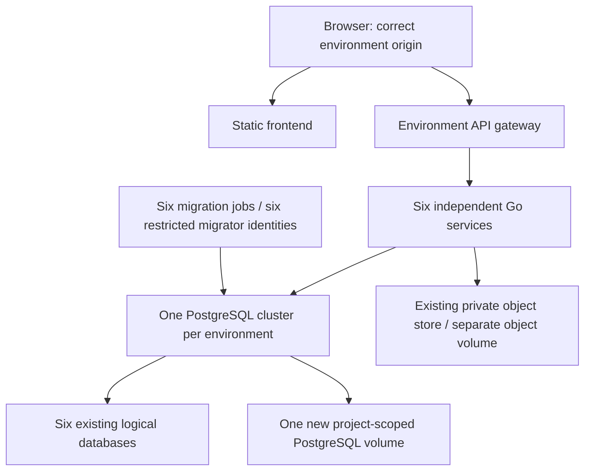

# Phase 1 plan — environment isolation and PostgreSQL infrastructure

This is a **plan only**, based on `main` at `a2df85f`, 2026-11-23. No commands in
the implementation sections were executed in Phase 0. Proposed paths, service
names, roles and variables below do not yet exist unless explicitly identified
as existing. Historical Phase 1/2 reports describe a different completed scope.

## Decision and first task

**READY WITH CONDITIONS.** Begin with an isolated QA consolidation rehearsal,
using a **new** project-owned PostgreSQL volume and preserving all six legacy
QA clusters/volumes. Implement admin/migrator/runtime separation before pointing
any application at the new server. Do not make DEV the first migration target.

The first implementation task is to add the staged QA PostgreSQL initializer
and explicit migration/backup preflight described below, with a fail-closed DEV
cutover gate. Before running it, obtain the owner's approved live inventory/
backup window; all environments were stopped during Phase 0. Merely preparing
files must not automatically start anything or replace local input files.

Do not expand this phase into cloud provisioning, frontend business logic,
service API redesign or a complete release-management implementation. The
fresh-checkout CI Compose failure is an enabling validation defect to diagnose
and fix safely; immutable RC/final promotion remains separate follow-on work.

## 1. Preserve these assets

- Three existing project identities, edge ports and three bridges per project.
- Six independent Go modules/services, all route/API contracts and migration SQL.
- Database names, table definitions, migration history, business records and
  service identifiers; changing ownership/grants must not rewrite business DDL.
- Existing DEV inputs, key material, data and Auth notifications. Never copy DEV
  records or credentials into QA/PROD-like. Generate distinct local rehearsal data.
- Three existing object volumes, buckets, scoped policies and service endpoints.
  PostgreSQL consolidation is not an object-store replacement or upgrade exercise.
- Existing gateway global/upstream/routing/snippet separation, Docker DNS, security
  and rate-limit behavior; preserve internal 8081–8086 ports and browser gateway boundary.
- All eighteen legacy DB volumes, even after the new baseline is deployed.
  Do not prune, attach them as a merged cluster, or delete them to rerun init.

## 2. Target architecture and transition accounting



The diagram repeats independently for DEV, QA and PROD-like. Proposed service
name: `postgres`; proposed logical volume key: `postgres-data`, yielding
`platform-dev_postgres-data`, `platform-qa_postgres-data`,
`platform-prodlike_postgres-data`. These names are **proposals**, not observed
resources. Use one reviewed same-major PostgreSQL image digest initially;
do not choose a major upgrade just because a newer major exists.

Steady-state target per project is ten long-running components (six Go apps,
frontend, gateway, PostgreSQL, object store) plus seven setup jobs (six migrations,
object initialization): **17 configured services**, not the current 22. An
additional bootstrap/readiness job, if justified, must be represented explicitly
instead of preserving hardcoded counts. Three DB volumes plus three existing
object volumes form six active persistence volumes across all projects.

Migration temporarily retains eighteen old DB volumes and adds three new ones:
**24 project data volumes total**, including the unchanged three object volumes.
Legacy stopped containers may also remain during the agreed rollback period.
The steady-state Compose definition will have only three PostgreSQL containers;
retaining stopped rollback resources temporarily is intentional, not proof the
final topology has eighteen active clusters. Removal of old containers or any
later data-volume cleanup requires a separate explicit retention decision.

Network membership stays `data` for PostgreSQL/object storage; Go apps retain
private access; frontend never gets DB-network membership. Do not publish 5432
or a service port. Keep DEV 3000/8080, QA loopback 3001/8081 and PROD-like loopback
3002/8082. No cross-environment external network/volume names.

## 3. File-level implementation work

| Existing path | Planned change / preservation |
| --- | --- |
| `infrastructure/docker/compose.yaml` | Final common baseline replaces six DB services with `postgres` and new volume; updates six app/migration DB_HOST and dependencies. Keep six apps/migrations, image keys, object resources, logs, networks and routes. Preserve old data resources throughout transition. Do not activate this globally before DEV cutover protection exists. |
| `infrastructure/docker/compose.dev.yaml` | Preserve development mode, port identity and inputs; use explicit staged cutover to the new DB only after recovery gates. No source mounting or debug port added without need. |
| `infrastructure/docker/compose.qa.yaml` | Preserve loopback/hardening/key isolation; replace six DB overrides with one reviewed shared-cluster constraint set in final layout. |
| `infrastructure/docker/compose.prod.yaml` | Same structural DB change and isolation; retain local rehearsal semantics and production app mode, not real Production claims. |
| `infrastructure/environments/dev/.env.example` | Document separate admin/migration/runtime inputs without overwriting actual DEV .env. Preserve six existing runtime DB password keys if practical. |
| `infrastructure/environments/qa/.env.example`, `infrastructure/environments/prod/.env.example` | Add clearly scoped proposed migration/admin inputs or file references; fix stale platform.py comment; preserve per-env image/origin/key settings. No usable secret values. |
| `infrastructure/scripts/platformctl.py` | Replace six `*-db` persistence/health assumptions with one cluster and six logical DB contracts; validate no legacy/new sharing and correct DB_HOST/DB_NAME/runtime users; explicit staged DEV-cutover guard; reject wrong credential scope; preflight image IDs before mutation; preserve target locks and immutable app image interface. |
| `infrastructure/scripts/backup.py` | Dump six logical DBs from the selected cluster instead of six DB containers; archive listings, object mirror and checksum protections retained; record server digest/version, DB owners/migration versions and separate role/secret recovery references without leaking credentials. Preserve ability to back up legacy layout during migration until retired deliberately. |
| `infrastructure/scripts/ci_models.py` | Diagnose actual fresh-runner Compose error with safe version/path/key diagnostics; add fresh-layout model cases without using a developer's real envs. Do not print resolved Compose/env/key content. |
| `infrastructure/docker/validate.ps1` | Require explicit target/override/ports and optional selected release, remove false cross-env Project-only selection, validate new component set and six DB checks. Keep GET/header/health smoke non-destructive. |
| `infrastructure/docker/validate-scaling.ps1` | Label/guard as an explicitly authorized disruptive QA/DEV exercise; correct environment selection and new layout checks; never call from PROD-like normal smoke. |
| `infrastructure/ansible/roles/preflight/tasks/main.yml` | Add migration-state/capacity/backup/image/target safety preconditions; preserve inventory mapping and Linux/Compose checks. |
| `infrastructure/ansible/roles/application/tasks/main.yml` | Integrate explicit new-layout selection and safe migration gates; no automatic DEV data copy/restore on ordinary deploy. |
| `infrastructure/ansible/roles/secrets/tasks/main.yml` | Target-specific admin/migrator/runtime rendering with no_log, containment and restricted paths. Keep DEV overwrite protection until explicit maintenance operation is approved. |
| `infrastructure/ansible/roles/health-check/tasks/main.yml` | New component set and six logical DB connectivity, preserving non-destructive profile for PROD-like. |
| `infrastructure/ansible/playbooks/{deploy,validate,health-check,rollback}.yml` | Keep ordinary deploy separate from data migration; image rollback must not imply DB rollback. Distinguish configuration checks from secret rendering. |
| `infrastructure/ansible/inventories/{dev,qa,prodlike}/group_vars/all.yml` and `vault.yml.example` | Explicit layout/cutover metadata and safe secret templates; retain local connection and existing names. Actual Vault enrollment remains owner-controlled. |
| `infrastructure/ansible/invoke.ps1` | Preserve Windows operator interface and safe bind paths; expose only necessary explicit migration/layout selection; registry credentials remain external, not baked in. |
| `tests/infrastructure/{test_platform,test_backup}.py` | Add shared-cluster mapping/legacy-volume protection/role-scope/manifest/checksum and refusal cases; retain existing eleven safety tests. |
| `.github/workflows/ci.yml` | Enable correct fresh-layout validation and safe isolated DB fixture checks as agreed; do not deploy to PC. Existing unit/build/scan checks preserved. |
| `docs/infrastructure/{architecture,deployment-guide}.md`, `docs/database.md`, `docs/development-setup.md` | Update living topology/roles/operator/restore instructions only after actual validation; keep historical reports immutable. |

Existing service `database/postgres.go` and `cmd/migrate/main.go` already accept
DB_HOST/DB_NAME/DB_USER/DB_PASSWORD. No business source changes are expected.
If connection-limit configuration must be exposed, propose only a small reviewed
configuration-layer change with compatibility checks; do not hide it as business
logic work. Never edit applied migration SQL to change role ownership.

**Proposed new paths (not currently implemented):**

| Proposed path | Purpose / reason |
| --- | --- |
| `infrastructure/postgres/init/10-databases.sh` | Empty-volume initializer: provision six DBs/roles from protected inputs using safe psql identifier/literal handling and no secret logging. Only bootstrap administration has superuser scope. |
| `infrastructure/postgres/verify-access.sql` | Secret-free read-only catalog/ownership/role/DB grant assertions; negative connection/DML/DDL tests need a separate isolated QA test context. |
| `infrastructure/docker/compose.postgres-rehearsal.yaml` | Temporary migration overlay: stage the new postgres service/volume in a selected existing project's private data network without replacing its legacy DBs or starting the full stack. Retire/merge after safe common-baseline cutover; not a fourth environment or duplicated application stack. |
| `infrastructure/scripts/migrate-postgres.ps1` | Explicit operator-driven inventory/backup/stage/restore/verify/cutover orchestration, target/confirmation gates, no default destructive action. Ordinary deploy never silently restores data. |
| `tests/infrastructure/test_postgres_layout.py` | New layout/cutover/legacy-volume-preservation safety tests if existing files become unwieldy. |

Do not create all proposed paths mechanically. The initializer, migration overlay
and explicit transition logic are justified by data preservation; combine small
helpers into existing tooling where simpler, while keeping ordinary deployment
and data cutover clearly separate.

## 4. Database and privilege contract

| Logical DB (existing name) | Runtime login (existing name, new limited target role) | Migrator/owner login (proposed new name) |
| --- | --- | --- |
| authentication_and_security | auth_app | auth_migrator |
| users | user_app | user_migrator |
| courses | course_app | course_migrator |
| enrollments | enrollment_app | enrollment_migrator |
| assessments | assessment_app | assessment_migrator |
| analytics | analytics_app | analytics_migrator |

Proposed cluster bootstrap login: `platform_admin`, never injected into apps or
normal migration containers. Use independent credentials for each environment
and role. Existing DEV runtime credentials can be preserved during a reviewed
cutover; new admin/migrator values must not replace user inputs automatically.
Do not export or blindly restore old cluster globals/passwords into rehearsals.

Target role rules:

1. Bootstrap admin remains administrative; do not repeat demotion of the legacy
   bootstrap role or rename it as an application role. Create fresh non-superuser
   runtime/migrator identities in the new cluster.
2. Runtime and migrator logins: NOSUPERUSER, NOCREATEDB, NOCREATEROLE,
   NOREPLICATION, NOBYPASSRLS. No runtime membership in admin/migrator roles.
3. Migrator owns only its service DB/schema/objects and can run existing DDL in
   that DB. Runtime receives CONNECT plus needed schema USAGE/table DML/sequence
   permissions, not database/schema ownership or DDL rights.
   Existing readiness handlers SELECT `schema_migrations`, so grant that table
   read-only SELECT while denying INSERT/UPDATE/DELETE/DDL; do not accidentally
   grant mutation through broad/default table privileges.
4. Revoke PUBLIC CONNECT/TEMP/CREATE where applicable across service/maintenance
   DBs, explicitly grant own-DB access, and test connection to each other service
   DB is denied. Review public schema owner semantics and template/maintenance
   access. Same server/network must not mean permission to other service data.
5. Set default privileges **for each actual object-creating migrator**, so future
   tables/sequences grant only that DB's runtime permissions. Verify functions,
   transactions, advisory locks, migration history and outbox behavior still work.
6. Restore dumps without original owners/grants into the intended migrator-owned
   target, then apply reviewed grants. Do not import six old superuser role sets.
   Compare logical schema/constraints/data before accepting ownership changes.
7. No application role receives cluster init/admin secrets. Applications still
   use their actual DB_* variables; migrator containers receive separate DB_USER
   and DB_PASSWORD inputs. Official PostgreSQL POSTGRES_PASSWORD_FILE can protect
   bootstrap delivery; existing Go secrets are not magically file-aware.

Initializer must fail closed on incomplete/unknown state. Official entrypoint
init scripts run only for empty PGDATA; repeat deployment must not require
resetting volumes to reconcile roles. A later explicit reconciliation path is
reviewed separately, never an automatic password/privilege rewrite on deploy.

## 5. Migration sequence and DEV preservation

### Gate A — before changing persistent layout

Obtain read-only live inventory in a later authorized maintenance window:
server/PGDATA/image digest, each database owner and size, role flags/memberships,
database/schema/object ACLs, extensions/collations/locale, migration version/dirty
state, pending outboxes and object-store recovery needs. Stopped-container config
does not replace this inventory. Record baseline IDs/volumes and protected input
fingerprints without printing values.

Select a compatible pinned PostgreSQL 18 candidate after triaging retained
gosu/libxml2 findings. Preserve major/data layout initially; compare base libc,
locale/collation/extension behavior before considering a distribution change.
Do not mount old PGDATA into an unreviewed newer major image.

Verify six logical dumps and separate role/secret recovery custody. Current QA
checksums are useful, but do not satisfy a current DEV backup or full restoration
gate. Preserve existing object data and notification artifacts independently.

### Gate B — isolated QA rehearsal first

Use QA's own data or synthetic QA records only. With the proposed additive
migration overlay, start **only** the new database/initializer components using
explicit service selection. Keep legacy DB services/data untouched. The new
volume must have a different name from every legacy volume; verify mount source
before allowing initialization or restore.

Restore all six QA DBs into the empty target under the intended owner/migrator,
apply grants, compare schema/migration/row counts and validate access denial
across DBs. Test the existing migration binaries on the restored schemas and on
a separate empty QA test fixture; no down/force reset on business data. Stage
QA applications against the target through the explicit rehearsal overlay/
operator path, never by globally changing DEV input files. Re-run auth/outbox/
storage/integration acceptance with QA identities, then repeat deployment to
prove idempotency.

### Gate C — PROD-like rehearsal and common baseline

Repeat sequentially with independent PROD-like inputs/data, then run only the
approved non-destructive release smoke. Full test/permission-denial mutation
exercises belong to QA test fixtures. Keep the existing peer-rehearsal resource
guard until measured PC capacity supports another operating policy.

Only after target proof and an explicit DEV-cutover refusal guard is in place
should the shared common Compose baseline replace the six DB definitions.
Capture a protected, runnable **legacy configuration bundle** with its matching
relative bind-path/image/input references for rollback; simply copying an old
Compose file to a different folder can break relative paths. Test the bundle
against the preserved source resources without deleting data or switching Git
branches as an operational rollback mechanism.

### Gate D — approved DEV maintenance cutover last

Do not alter DEV credentials/data or recreate apps while preparing files. During
an approved window: quiesce writes and workers, capture notifications, take and
verify current six-DB backups, stage/restore the new DEV cluster, validate data/
privileges/migration histories, then point DEV apps to it and perform agreed
smoke checks. Keep old DEV containers/volumes available but do not run old/new
writers against divergent data. Record the source/target digests and recovery
checkpoint. Reopen writes only after acceptance.

## 6. Rollback and recovery contract

Before reopening writes, a failed cutover may return to the preserved legacy
configuration and untouched old volumes after stopping the target writers in an
approved operation. **After target writes are accepted, the old DBs are stale.**
Automatic switch-back would discard accepted work. Use operator-directed
forward repair or an explicitly tested reverse logical migration/reconciliation
with a new backup. Image rollback is not data rollback; existing helper rollback
must never pretend to reverse database migrations.

Keep old volumes for an agreed retention window. No cleanup command includes
`down -v`, prune, reset, automatic DROP DATABASE or unreviewed restore `--clean`.
No destructive restore targets an existing DEV DB. A recovery test uses an
empty, uniquely identified QA target and explicit approval in the implementation
phase. Capture dump integrity, schema/data comparisons, six migration versions,
object checks and recovered secret custody, not just health endpoints.

## 7. Resource and health design

Engine baseline is 8 CPUs/~7.63 GiB shared with Desktop tooling. A provisional
shared-cluster cap of 1 GiB/2 CPUs per environment is a **starting experiment**,
not a certified limit. Do not carry six independent 512 MiB limits into a single
cluster or claim three loaded environments fit because containers start.
Current per-app ceilings plus object/edge/PG ceilings can exceed the host when
all environments peak; keep sequential rehearsal validation and measure load.

Five service pools alone allow 100 connections, plus Analytics defaults,
migrators/backups/health/operators and any replicas. Candidate max_connections
such as 160 must be justified against actual combined pools/work_mem/RAM;
alternatively expose smaller app pool limits through a reviewed config-only
change. Preserve administrative connection headroom and test exhaustion behavior
on QA, without adding a pooler product by default.

Postgres health: TCP readiness of final listener plus a separate non-destructive
six-DB/role connectivity check. Applications continue their DB/schema readiness;
Assessment also checks object storage. Keep read-only migration-table access for
runtime identities. Release validation must verify exact expected versions
(current source: Auth 6, User 4, Course 1, Enrollment 1, Assessment 3, Analytics 1),
since existing Auth/Assessment readiness accepts earlier versions. Setup must
verify initialization complete before migrations run. Gateway
health remains independent of upstream readiness. Container resource/readonly/
capability settings must be retested after the new PG image/initializer choice.

## 8. Exact validation commands for later execution

These are **planned**, not Phase 0 test results. From repository root, after
implementing the target layout and initializing protected local inputs:

```powershell
docker version
docker info
docker compose version
.infra-venv/Scripts/python.exe -B infrastructure/scripts/platformctl.py config --environment dev
.infra-venv/Scripts/python.exe -B infrastructure/scripts/platformctl.py config --environment qa
.infra-venv/Scripts/python.exe -B infrastructure/scripts/platformctl.py config --environment prodlike
.infra-venv/Scripts/python.exe -B -m unittest discover -s tests/infrastructure -v
```

Explicit project arrays for planned target checks:

```powershell
$qa = @('compose','--env-file','infrastructure/environments/qa/.env','-p','platform-qa',
  '-f','infrastructure/docker/compose.yaml','-f','infrastructure/docker/compose.qa.yaml')
$prodlike = @('compose','--env-file','infrastructure/environments/prod/.env','-p','platform-prodlike',
  '-f','infrastructure/docker/compose.yaml','-f','infrastructure/docker/compose.prod.yaml')
docker @qa config --quiet
docker @prodlike config --quiet
# Execute deploy only after migration/backup/privilege gates and owner authorization:
powershell -NoProfile -File infrastructure/ansible/invoke.ps1 -Environment qa -Playbook deploy
powershell -NoProfile -File infrastructure/ansible/invoke.ps1 -Environment qa -Playbook deploy
.infra-venv/Scripts/python.exe -B infrastructure/scripts/platformctl.py health --environment qa
docker @qa exec -T gateway nginx -t
docker @qa exec -T frontend nginx -t
docker @qa ps -a
```

Proposed read-only SQL verification after the new `postgres` service and
`infrastructure/postgres/verify-access.sql` are implemented:

```powershell
Get-Content -Raw infrastructure/postgres/verify-access.sql |
  docker @qa exec -T postgres sh -c 'exec psql -X -v ON_ERROR_STOP=1 -U "$POSTGRES_USER" -d postgres'
```

SQL assertions must inspect `pg_roles` flags/memberships, six database owners,
runtime/migrator grants and migration version/dirty state **without pg_authid
password data**. Runtime authentication and attempted forbidden cross-DB/DDL
operations require a new QA-only test helper with secrets delivered through
protected inputs. Its CLI is not invented here before implementation. Query
row counts/checksums from each actual source and restored target as part of the
approved migration script; do not publish business records in logs.

Ansible syntax: run the existing wrapper with `-SyntaxCheck` for each inventory
and four playbooks, or native Ansible after WSL integration. Repeat QA deploy
must report no unexpected change. After stopping only QA using the existing
helper, run sequential PROD-like deployment/repeat/health/Nginx smoke and stop
only that rehearsal; keep DEV's runtime untouched until its dedicated window.

Backup validation after adapting the script:

```powershell
.infra-venv/Scripts/python.exe -B infrastructure/scripts/backup.py create --environment qa
.infra-venv/Scripts/python.exe -B infrastructure/scripts/backup.py verify --path <actual-new-QA-snapshot>
```

Run actual restoration only through the reviewed explicit empty-target
procedure, not a guessed CLI. Go QA integration commands are `go test ./...`
per module with isolated, migrated `auth_test`, `users_test`, `courses_test`,
`enrollments_test` URLs. Those are disposable testing fixtures, not extra
persistent service databases. Do not point DB test suites at business DBs or
execute the full suite in PROD-like. Rerun fresh GitHub CI only after the owner
authorizes future implementation/push; never from Phase 0.

## 9. Acceptance criteria and blockers

- Final Compose defines one PG per env and six correct database connections,
  with no published DB ports, cross-env sharing or accidental legacy mounts.
- Six application runtime logins are non-superuser/non-owner, can perform
  required own-DB DML and cannot connect to other service DBs, create schemas/
  tables or assume admin/migrator roles. Migrators work only in intended DBs.
- Three independent new DB volumes and unchanged three object volumes are active;
  eighteen legacy DB volumes are still retained until explicitly approved later.
- Source/restored data, schema, migration histories and ownership/grants match
  the approved transformation; recovery evidence exists before DEV cutover.
- Target stack counts/dependencies, backup scripts, tests and all operator
  interfaces reflect the new topology; no stale `*-db` assumptions remain.
- Repeated deployment/initialization is safe, role reconciliation cannot silently
  reset secrets, and ordinary deployment cannot start an unapproved DEV cutover.
- Resource/connection limits are measured; health, gateway, auth, object and
  required QA integration checks pass with actual test evidence. PROD-like runs
  only deployment/non-destructive smoke, not disruptive test suites.
- Supporting-image critical/high findings are triaged with compatible remediation
  or narrowly justified owner acceptance; no vulnerability policy is weakened.
- Rollback/write-divergence policy is approved, old configuration is runnable,
  and owner agrees the maintenance/recovery/custody window.
- Living docs reflect verified outcomes; no claim of live Production HA/DR.

External blockers: stopped services prevent current catalog/dump verification;
native WSL socket remains unavailable; GitHub package access/protection needs
owner review; no cloud target exists. None justifies data deletion or silently
changing the approved architecture. Full CI/GHCR release promotion and frontend
integration are follow-on gates, not reasons to redesign the six services.
