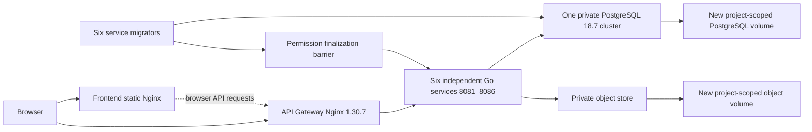

# Phase 1 implementation — environment isolation and PostgreSQL

Date: 2026-11-23. Baseline: `main`, `a2df85f2bd655ccbe155ce781a2c95b9d8b41f2d`.
Status: **PARTIALLY COMPLETED**. Database infrastructure, restore, SQL privilege
tests and persistence rehearsal passed. A real Authentication integration failure
remains an application compatibility gate; no environment cutover is authorized.

## Baseline and selection

The five Phase 0 documents were read and preserved, along with the historical
phase reports and original validation ledger. Their observations were checked
against source, Docker metadata and retained QA backups. The original 66
containers were stopped at entry; the old description of a running DEV was
historical. There are six independent PostgreSQL 18.7 containers per legacy
environment, six Go/Gin services, frontend, gateway and private object storage.

`infrastructure/docker/compose.yaml` plus the existing DEV/QA/PROD-like override
remains the **legacy default**. No existing environment was redirected. The
target is selected separately using `compose.target.yaml`, which extends existing
application definitions and `compose.postgres.yaml`; do not combine the target
with legacy Compose files. The separate selection implements the new safety
boundary instead of executing the cutover envisioned in the older Phase 0 plan.

| Selection | Project | Frontend / gateway | PostgreSQL persistence |
| --- | --- | --- | --- |
| Legacy DEV | `platform-dev` | 3000 / 8080 | Existing six volumes, unchanged |
| Legacy QA | `platform-qa` | 3001 / 8081 | Existing six volumes, unchanged |
| Legacy PROD-like | `platform-prodlike` | 3002 / 8082 | Existing six volumes, unchanged |
| Inactive DEV target | `platform-dev-target` | Loopback 3000 / 8080 | `platform-dev-target_postgres-data`, not created |
| Inactive QA target | `platform-qa-target` | Loopback 3001 / 8081 | `platform-qa-target_postgres-data`, not created |
| Inactive PROD-like target | `platform-prodlike-target` | Loopback 3002 / 8082 | `platform-prodlike-target_postgres-data`, not created |
| Executed QA rehearsal | `platform-qa-pg-rehearsal-20261123` | Loopback 3101 / 8181 | New `platform-qa-pg-rehearsal-20261123_postgres-data` |

The three inactive target inputs were generated independently, model-validated
and pinned to local image digests. They have independent bootstrap, migration,
runtime, signing and object-store secrets. No target project was started.
Target host ports intentionally match their eventual environment; simultaneous
legacy/target operation on those ports is forbidden until an approved cutover.

Target projects each own `edge`, `backend`, `data`, `postgres-data` and
`minio-data`; no external volumes or driver aliases. Only frontend and gateway
publish ports. Backends retain outbound access for verified external dependencies;
the networks are not incorrectly marked `internal: true`. Existing Nginx Docker
DNS/upstreams, routes and service ports remain unchanged. One singleton database
has an explicit project-derived container name; scalable application services do
not have fixed container names.

## Database identity and ownership design

| Service / directory | Database | Existing application identity | Target migration / owner | Target runtime |
| --- | --- | --- | --- | --- |
| Authentication / `services/security-and-authentication` | `authentication_and_security` | `auth_app` | `auth_migrator` | `auth_app` |
| User / `services/user` | `users` | `user_app` | `user_migrator` | `user_app` |
| Course / `services/course` | `courses` | `course_app` | `course_migrator` | `course_app` |
| Enrollment / `services/enrollment` | `enrollments` | `enrollment_app` | `enrollment_migrator` | `enrollment_app` |
| Assessment / `services/assessment` | `assessments` | `assessment_app` | `assessment_migrator` | `assessment_app` |
| Analytics / `services/analytics` | `analytics` | `analytics_app` | `analytics_migrator` | `analytics_app` |

Existing identities are identified from configuration, not a fresh live query
against legacy clusters. Legacy bootstrap-superuser exposure is **not repaired**
by provisioning the new cluster; it remains a cutover prerequisite.

`platform_admin` alone administers the new cluster. Applications and routine
migrations never receive its password. Each migrator owns its database, public
schema and migrated objects, without superuser, role/database creation,
replication or bypass-RLS flags. A separate non-login owner is unnecessary for
the inspected migrations; there are no cross-service memberships. Database
ownership gives the migrator service-local DDL authority, not cluster authority.

PUBLIC database access and public-schema creation are revoked. Runtime roles
receive CONNECT, schema USAGE, table SELECT/INSERT/UPDATE/DELETE and sequence
USAGE/SELECT, without DDL, TRUNCATE or ownership. `schema_migrations` is
read-only to runtime roles. Default table privileges grant SELECT only; the
explicit post-migration finalizer grants DML solely on business tables. This
avoids transient runtime write access to migration history. Default function
EXECUTE to PUBLIC is revoked for future migrator-owned functions. Existing
migrations contain no custom extension installation requiring cluster privilege.

`10-platform.sh` runs only during **fresh-volume initialization** and uses
`ON_ERROR_STOP`. A success marker is created only after all provisioning SQL
succeeds. Health requires the marker plus TCP readiness, so a partially initialized
volume cannot pass health on restart. Initialization does not run on an existing
volume and is not used as a password-rotation mechanism.

Six existing Go migration jobs use `/app/<service>-migrate` with
`-path /app/migrations -direction up` and their own migrators. `db-permissions` runs
only after all six migrations succeed, reads migration credentials from a
protected file and applies `permissions.sql` per service. Applications depend on
this successful barrier. No new domain service or schema migration was invented.

## Resources and secrets

Desktop evidence: Linux engine 29.9.3, context `desktop-linux`, Compose 5.7.0,
8 CPUs and approximately 7.63 GiB engine memory. Five service pools permit up
to 20 connections each; Analytics uses driver defaults. A 160-connection ceiling
allows these five pools (100), the local Analytics concurrency, six migration
connections and administrative headroom. PostgreSQL receives 1 GiB, 2 CPUs,
128 MiB shared buffers, 4 MiB work memory and 256 PIDs. Work memory is per
operation; this is a bounded local rehearsal setting, not a load-tested capacity
guarantee. Run environments sequentially. Applications receive 384 MiB/1 CPU;
edges 128 MiB. No claim of high availability or production disaster recovery.

`postgres_rehearsal.py init` exclusively creates ignored, ACL-restricted inputs
under `.infra-state/phase123/qa-rehearsal`. It refuses overwrite. Windows ACLs
restrict the directory to the current user and SYSTEM; generated credentials
are not printed. Bootstrap/admin material is mounted as Compose file secrets;
existing applications and Go migration jobs still consume DB passwords through
environment variables. Local Compose secrets are file mounts, not encrypted
Swarm storage; Docker administrators can inspect application environments.
Auth's signing key is mounted only where required. The permission job receives
migrators, not admin or application signing secrets.

Safe templates are `infrastructure/environments/{dev,qa,prod}/postgres.env.example`.
`prepare_postgres_target.py --environment ...` creates separate **inactive**
inputs under `.infra-state/phase123/targets`; it cannot deploy and refuses to
overwrite inputs. Protect and separately escrow secret recovery material.

## Executed QA rehearsal and restore

1. Inventoried and fingerprinted all 66 legacy container IDs/start timestamps,
   23 existing volumes and preserved-document hashes before changes.
2. Created only the new rehearsal project/network/volume and fresh credentials.
3. Initialized all six databases and verified real role/ownership/access queries.
4. Verified existing QA snapshot `20261123T115640Z-85dc94fd`: manifest checksums
   covered 12 files. Manifest SHA-256:
   `0169d230a5b1b4f29e28c1c8bbe6b81db1773f1d2738d07fdc9b501f2b34ead2`.
   Source is recorded as QA / `platform-qa`, PostgreSQL 18.7. Each custom dump's
   TOC and dumped-from/dumped-by major version were checked before restoration.
5. Restored all six dumps with `pg_restore --no-owner --no-acl --exit-on-error`
   into **empty new databases**, authenticated as their migrators. The restore
   refuses nonempty schemas; it does not use `--clean` or mount any old volume.
   Objects therefore acquire the new service-local ownership. Source object
   storage and configuration were **not restored** into the new application.
6. Executed all six migration jobs against restored databases and verified clean
   schema versions: Auth 6, User 4, Course 1, Enrollment 1, Assessment 3, Analytics 1.
   Fresh empty disposable test databases also exercised all six migration paths.
7. Ran real SQL checks for each of 12 login roles: no superuser/CREATEDB/CREATEROLE;
   other service databases denied; runtime cannot CREATE DATABASE, CREATE ROLE,
   CREATE TABLE/SCHEMA, assume migrator role or update migration history.
   Migrators can own-schema DDL inside a rolled-back probe but cannot create
   cluster roles/databases or connect to unrelated service databases.
   All 12 also failed DROP of an unrelated empty, admin-owned probe database.
8. Verified runtime SELECT and transactional INSERT/UPDATE/DELETE on temporary
   permission-probe objects, table/sequence grants, public object ownership and
   unchanged restored business fingerprints after tests. These checks are
   permission tests, not complete authorization/business-workflow coverage.
9. Recreated the new PostgreSQL container with the same **new** volume. Canonical
   per-table row counts/content hashes matched. Repeated the preservation and
   privilege checks when selecting the reviewed same-major supporting image.
10. Executed a negative initialization fixture using disposable tmpfs data:
    deliberately invalid SQL exited 3, with no success marker or silently healthy
    cluster. No legacy database was used.
11. Created six new custom-format logical dumps plus password-free role/owner/
    membership/data-fingerprint metadata under protected external directory
    `%LOCALAPPDATA%/UCM/backups/qa-rehearsal/20261123T163755Z-21699eee`.
    TOCs and the seven-file checksum manifest passed. This new backup was not
    restored a second time; restoration evidence above uses the verified source
    QA backup. This is a PostgreSQL backup, not a full object-store/secret DR test.
12. Enhanced the backup with `pg_dumpall --globals-only --no-role-passwords`,
    rejecting unexpected password clauses. A second protected snapshot,
    `20261123T165903Z-8c294f57`, passed all eight manifest checks (six dumps,
    globals SQL and recovery metadata). Only the new PostgreSQL was started for
    this read-only backup and then stopped. The globals file is recovery evidence;
    review it against fresh provisioning rather than blindly replaying it over
    existing roles. Passwords must be restored from separate secret escrow.

Evidence is retained locally under ignored `.infra-state/phase123`: protected
`restore-evidence.json`, `persistence-evidence.json`, test logs and final safety
metadata. Do not commit that directory or upload its credentials.

## Application compatibility gate

All six baseline unit/vet/module/build paths passed. Real database-backed suites
passed for User, Course, Enrollment, Assessment and Analytics on disposable DBs
in the new cluster. Authentication **failed**
`TestServicePermissionsAndAudit` at
`services/security-and-authentication/internal/service_test.go:504`:
11 expected permissions versus 23 seeded by migrations. Inspection also found
the domain permission allowlist retains 11, so treating this solely as a stale
test would be unsafe. Application engineers must reconcile the permission
catalog/validation and tests. No assertion, migration or business logic was changed.
The failed suite remained a failed command. Temporary fixture DBs were removed;
the six restored business databases retained their fingerprints.

An intermediate Analytics fixture run failed while the grant helper was being
refined. After freezing the canonical SQL, its fresh migration/Go checks passed
on a separate `--only analytics` retry; this does not erase Auth's failure.

## Backup, eventual cutover and rollback

Do not deploy `compose.target.yaml` to a legacy project or reuse old volumes.
Before any separately authorized cutover: inventory live roles/extensions and
owners; fix Auth compatibility; verify current environment-specific backups and
external config/secret escrow; establish a write fence; reconcile row counts and
content checks; restore with `--no-owner --no-acl` as each service migrator; run
migrations, the grants barrier, SQL tests, connectivity and approved API checks;
then explicitly select the target project/ports. No database major upgrade is
part of this change. Existing Ansible remains wired to the legacy topology and
must not be used as though it deploys this target.

Retain legacy volumes and a verified cutover-time backup. Before new writes,
rollback can restore the old selection/ports. After new writes, switching to stale
legacy data risks loss: stop writes and use a reviewed reconciliation/forward-fix
or restore procedure. Runtime ownership/ACLs must be reprovisioned from the role
model; global metadata here intentionally excludes passwords and is not a
credential recovery substitute. Full disaster recovery and cross-environment
data migration are not claimed.

**No DEV cutover, existing QA replacement or PROD-like cutover occurred.**
All legacy containers and volumes were preserved. The new rehearsal stack was
gracefully stopped; its new volumes are retained. PostgreSQL vulnerability review
and the remaining object-store finding are detailed in the Phase 2 report.

## 2026-11-24 shutdown recovery and fresh revalidation

The shutdown recovery found the application remediation, new reports and raw
2026-11-23 evidence already present as uncommitted work. All were preserved.
The earlier summary claimed phase/ledger addenda had been appended, but inspection
found them absent; this dated addendum completes that unfinished documentation.
Earlier failure statements above remain historical, not the current verdict.

Fresh evidence root: `.infra-state/remediation/recovery-20261124T020340Z`. Exact process arguments and exit codes are in
`results.json`; sanitized initial resource identities/file hashes are in
`initial.json`; final baseline preservation is in `final-safety.json`.

| Phase | Current acceptance | Remaining condition |
| --- | --- | --- |
| 1 | **COMPLETED AND VERIFIED** | Accepts isolated target/rehearsal only; legacy cutovers remain unauthorized. |
| 2 | **IMPLEMENTED — OWNER APPROVAL PENDING** | Owner must explicitly approve the exact-digest, guard-mandatory local-only Silo exception, or select a separately evaluated vendor option. |
| 3 | **IMPLEMENTED — REMOTE VERIFICATION PENDING** | GitHub-hosted execution has not been authorized or triggered. |

Fresh named database-backed `TestServicePermissionsAndAudit` passed (0.21s).
All six full backend suites, module verification/tidy, vet and builds passed on
fresh disposable fixture databases. SQL confirmed 23 distinct permissions and
unchanged default role grants: ADMIN 19, LECTURER 8, STAFF 4, STUDENT 2.
Migrations 000005/000006 added twelve valid Assessment/Analytics permissions that
the original eleven-entry Auth allowlist omitted. The existing correction adds
those definitions without changing migrations or broadening default grants.
The full 23-permission inventory and classification remain in
`remediation-authentication-permissions.md`. Authorization/audit and caller-boundary
regressions passed within the Authentication suite; the separate middleware matrix
checks 401/403/204 for all catalogue entries. No obsolete identifier was identified.

The exact PostgreSQL candidate remains
`ucm-postgres@sha256:cb90d02d2e03c00889b7d8c08e1bf522ef62891b121c02d7b0a4239170661a4c`.
Fresh SQL returned server 18.7. All six role/ownership, runtime DML, denied DDL,
administration, migration-history mutation and cross-database checks passed.
All six verified backup archives were restored into new disposable databases;
content/ownership checks passed and only those fixtures were removed. Recreating
the isolated PostgreSQL container reused the retained rehearsal volume and
preserved all six data fingerprints; privilege checks passed again. Fresh fixture
migrations passed for all six services. The earlier extension inventory and two
no-change migration repetitions remain 2026-11-23 evidence, not newly repeated
claims. No legacy database was started, upgraded or modified.
