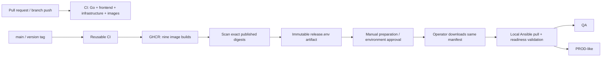

# Phase 4 — CI, image publishing and deployment preparation

No Git commit, push, workflow dispatch, package publication or repository setting
change was performed. New workflows are local implementation pending repository
review. Local checks are distinguished from GitHub-hosted execution below.

## Pipeline architecture



`.github/workflows/ci.yml` handles pull requests, non-main branch pushes and
reusable calls. Main/version publications call the same CI first, avoiding a
second independent main CI workflow. No prior workflow existed to preserve.

Backend validation uses a six-service matrix and each actual `go.mod` version:
Go formatting, module download/verification, `go mod tidy -diff`, tests and vet.
Windows CRLF initially caused a tidy diff containing only line endings. Go
source/module/checksum LF attributes now make checks consistent across Windows
and Linux. Formatting existing Go files produced 13 content diffs; `git diff -w
--ignore-blank-lines --exit-code -- services` passed, confirming whitespace-only
changes. No Go business logic or API contract was changed.

Frontend CI uses Node 22, Corepack and pnpm 10.34.3, frozen-lockfile install,
available lint/test scripts, production build and production dependency audit.
There are currently no lint or unit-test scripts; the workflow explicitly
reports their absence instead of inventing commands or tests. `format` is a
mutating formatter and is not run as an automatic source rewrite in CI. Vite's
two existing unresolved SVG references remain application-team work.

Infrastructure CI runs eleven deployment/backup safety tests, all three fresh-checkout
Compose models, all inventories and 12 playbook syntax checks, Git whitespace
validation and full-history redacted secret scanning. Disposable QA/PROD-like
inputs generated on the ephemeral runner never connect to the developer's PC.
DEV model validation uses examples and does not generate/overwrite local DEV
credentials. A nine-image matrix builds the six services, frontend, gateway and
existing storage initialization helper, with the exact contexts/Dockerfiles in
the workflows. Backend/migration binaries share their respective service image.
Gateway/frontend Dockerfile builds include `nginx -t`.

Image scans use Trivy HIGH/CRITICAL gates without ignoring unfixed issues.
Gitleaks and Trivy images are pinned to pulled/verified digests. Only official
GitHub and Docker actions are used, pinned to full commit SHAs looked up from
their official GitHub repositories. Renovation of these pins must remain a
reviewed maintenance action.

## Publishing and promotion

`publish-images.yml` publishes only after reusable CI succeeds, and only on
`main`, `v*` tags, or a manually requested run of one of those trusted refs.
Untrusted pull requests never receive publishing permissions. Global permission
is `contents: read`; only the publisher job adds `packages: write`.
`docker/login-action` uses the short-lived built-in `GITHUB_TOKEN`; no PAT is
required by the workflow. OCI source/version labels, BuildKit cache scopes,
SBOM and provenance metadata are emitted.

Image namespace:

```text
ghcr.io/kavindacena99/university-course-management-system/
  auth, user, course, enrollment, assessment, analytics,
  frontend, gateway, assessment-minio-init
```

Tags include full `sha-<commit>`, the trusted branch, and semantic release tags
where applicable. `latest` is disabled. Tags are discovery labels, not immutable
deployment identifiers. Each exact published digest is scanned before its
deployment reference is released. The final `immutable-release` artifact holds
exactly nine `*_IMAGE=ghcr.io/...@sha256:...` entries.

The same artifact is selected for QA and PROD-like; applications are not rebuilt
per environment. Configuration, JWTs, database/object credentials and frontend
CSP stay environment-specific outside image layers. The existing frontend API
build variable is unused by application code; introducing future build-time
environment-specific API behavior would need a runtime configuration design to
preserve this promotion rule.

`prepare-deployment.yml` is manual, reads a successful publication from this
repository, validates the manifest, selects QA/PROD-like's GitHub environment,
and emits an approved local deployment artifact. It does not SSH, reach the PC,
provision a server or run a self-hosted runner. Actual deployment is the local
Ansible command with `deployment_mode=pull` and `release_manifest=<absolute path>`.
Missing/invalid manifests and missing previous rollback releases fail safely.

This follows [GitHub's container publishing model](https://docs.github.com/en/actions/tutorials/publish-packages/publish-docker-images).
No package was published from this session, so registry pull/promotion and
rollback against real publication digests remain unexecuted.

## Local validation

- All six services passed `go mod verify`, `go mod tidy -diff`, `go test ./...`
  and `go vet ./...` after LF normalization. `gofmt -l services` was empty.
- `rhysd/actionlint:1.7.12` accepted the three workflows. Fresh-checkout models
  and eleven safety tests passed. Final workflow validation is repeated after
  security integration; detailed outcomes are in the validation ledger.
- Frontend `pnpm audit --prod --audit-level high` reported **No known
  vulnerabilities found**. The full image-build run uses separate `:phase345`
  local tags so DEV's running images are not replaced.
- The first Gitleaks scan reported one generic-key match in a Phase 1/2
  HTTP-status prose row. The redacted finding was reviewed as non-secret route
  test results. The custom config extends all default rules and excludes only
  that exact non-secret route-status fragment in that exact file; no directory-wide or credential
  baseline exclusion was introduced. Final rescan outcome is in Phase 5.
- Docker Hub initially timed out pulling Trivy; retry succeeded. Scanner
  database download and final image-scan outcomes are recorded separately.

The final security-updated six Go modules passed all checks using Go 1.27.3;
all nine application/helper builds passed, and their final strict scans each
reported zero HIGH/CRITICAL findings. The three workflows passed actionlint;
all 12 final playbook/inventory syntax combinations passed. See the
[validation ledger](validation-ledger.md) for commands and the full file list.

## Repository-owner administration

Before merging/enabling these workflows, review Actions permissions and package
policy. Add required backend/frontend/infrastructure/image checks to main branch
protection, require reviewed PRs, protect release tags and pin any required
workflow ownership review through the repository's normal review policy.
Configure `qa` and `prodlike` environments, required reviewers for PROD-like
preparation, trusted deployment branches, and a separate protected `production`
environment only when live servers exist. Review first-created GHCR package
visibility and repository Actions access; do not assume packages are private or
accessible until verified. Local private pulls require operator authentication
outside Git. No GitHub administrative settings were changed here.

Read-only administration checks returned Actions enabled with `allowed_actions=all`
and zero configured GitHub environments. Reading main branch protection returned
HTTP 403 with GitHub's private-repository plan restriction. No protected
deployment approval or enforced main-branch checks are claimed. The owner must
resolve plan/policy availability before relying on those controls.

## Status

- **COMPLETED AND VERIFIED:** local backend checks, dependency audit, model/safety
  checks, workflow parsing/actionlint and actual Docker build contexts.
- **IMPLEMENTED BUT NOT RUNTIME-VERIFIED:** GitHub-hosted CI, GHCR publication,
  SBOM/provenance artifacts, protected manual preparation and registry promotion.
- **REQUIRES MANUAL USER ACTION:** review/commit/merge, enable trusted workflows,
  repository/environment/package administration and authorize first publication.
- **DEFERRED UNTIL CLOUD SERVERS ARE AVAILABLE:** executable remote deployment,
  provider identity, remote inventories and live Production approval workflow.
